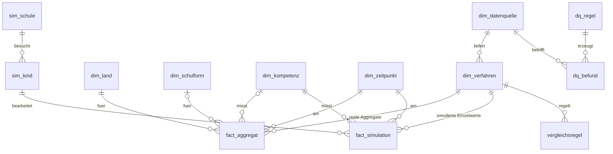

# Datenmodell und Data Lineage

Umsetzung: [`database/schema.sql`](../database/schema.sql), SQLite. Felder: [Datenwörterbuch](data_dictionary.md).



## Fünf Entwurfsentscheidungen

1. **Zwei getrennte Faktentabellen.** `fact_aggregat` (real) und `fact_simulation` (künstlich) haben keine gemeinsame Sicht.
   Das Schema lehnt simulierte Zeilen ohne Kennzeichnung ab.
2. **Das Erhebungsverfahren bestimmt die Bedeutung.** Eine Zahl ist erst mit Grundgesamtheit und Skala interpretierbar.
   Deshalb hat eine Quelle mehrere Verfahren, zum Beispiel Destatis Tabelle 04 und 07.
3. **Kompetenzbereiche je Rahmen.** „Daten und Zufall“ in Klasse 9 und im Rahmenplan 5/6 sind zwei Einträge.
4. **Fehlend ist nicht null.** Nicht ausgewiesene Werte stehen mit Status und Grund in der Tabelle.
5. **Schulformen nur für M-V zugeordnet.** Die Zuordnung der Destatis-Gruppen ist durch den zahlengenauen Abgleich mit dem
   Statistischen Amt gestützt. Für andere Länder gilt sie nicht.

## Vergleichbarkeit als Sperre

`vergleichsregel` ist eine Positivliste. `src/transformation/compare.py` lässt einen Vergleich nur zu, wenn

1. Kennzahl, Klassenstufe und Kompetenzbereich gleich sind,
2. beide Werte ausgewiesen sind,
3. sich genau eine Dimension unterscheidet (Zeit, Land oder Quelle),
4. eine Regel mit Status `freigegeben` existiert und keine Sperre greift.

Sonst entsteht ein Fehler mit Begründung. `vorgeschlagen` reicht nicht: Freigaben trifft die Projektleitung.

## Data Lineage

```
Originaldatei (SHA-256, Abrufzeit)
  -> Spaltenvertrag (parse_real.py): Blatt, Zelle, Rohtext
  -> Deutung (normalize.py): Zahlenformat, Alias
  -> fact_aggregat: Wert + Rohwert + Fundstelle + Status
  -> v_lineage -> Auswertung mit Regel-ID und Fundstelle
```

Beispiel: M-V, Klasse 9, 2024, Globalskala = 471. Herkunft: Q2, Blatt „Tab. 4.1web“, Zelle P14. In der Datei steht dort die
Schreibweise „Mecklenburg-Vormpommern“, die unverändert in `land_roh` erhalten ist.

Simulierte Werte verweisen über `roh_zeile` auf die Zeile in `SIM_ergebnisse_roh.csv`.
