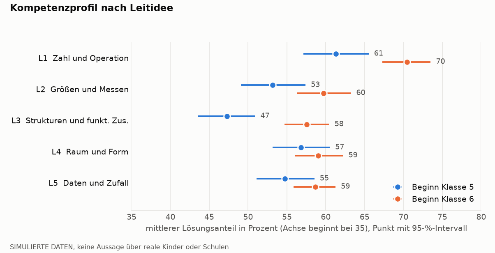
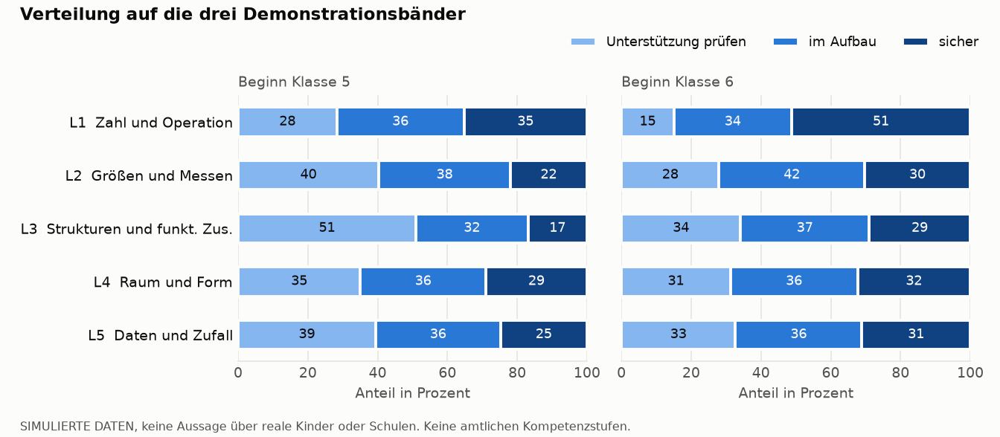
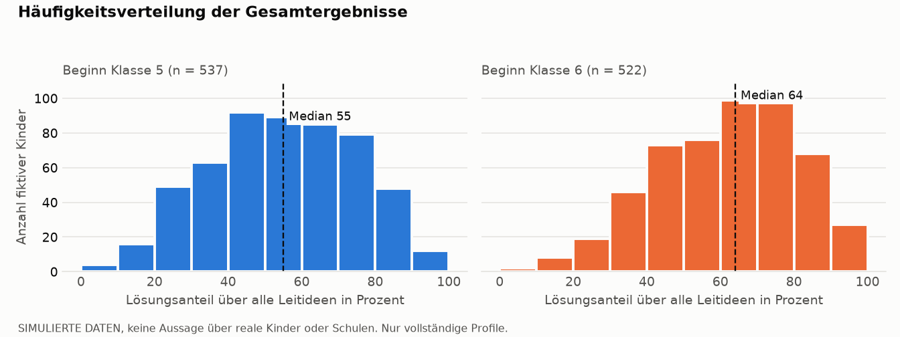
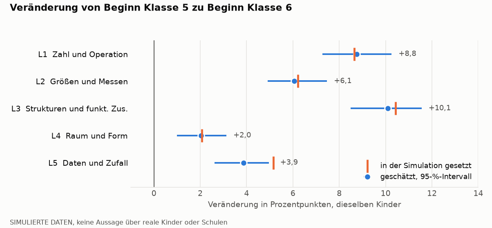
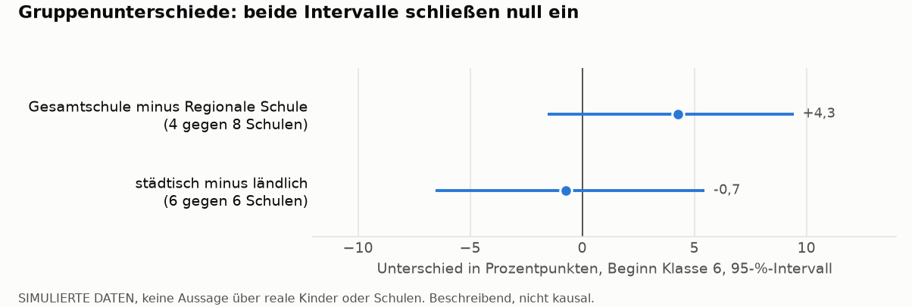
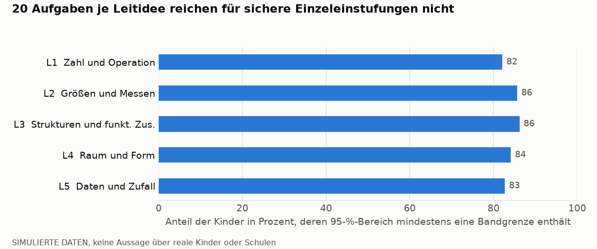
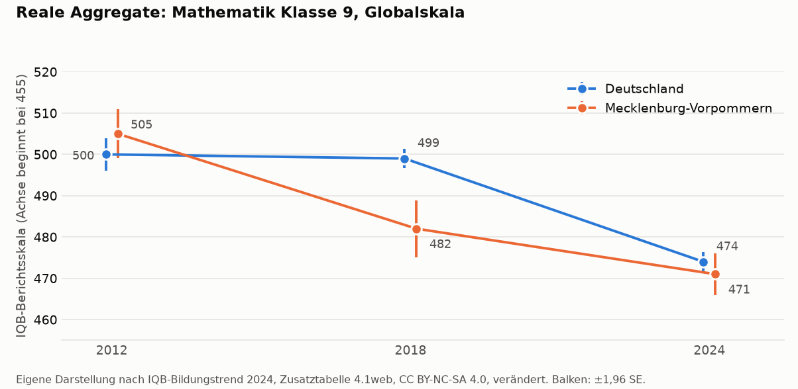

# Exemplarische Bildungsanalyse Mathematik, Klassenstufe 5 und 6

**SIMULIERTE DATEN.** Alle Kinder und Schulen sind erfunden. Die Ergebnisse zeigen analytische Möglichkeiten und sagen nichts über tatsächliche Kinder, Schulen oder das Land aus.

Automatisch erzeugt durch `python -m src.run_all`. Startwert der Simulation: 20261124.

## Was gemessen wird

Lösungsanteil in einem fiktiven Test mit 20 Aufgaben je Leitidee (L1 bis L5 nach Rahmenplan Mathematik M-V 2026).
Die drei Bänder (unter 50, 50 bis unter 75, ab 75 Prozent) hat die Projektleitung festgelegt. Sie sind **keine**
amtlichen Kompetenzstufen und keine Mindeststandards.

## 1. Kompetenzprofil

| Messung | Leitidee | n | Mittel % | 95-%-Intervall | SD |
|---|---|---|---|---|---|
| Beginn Kl. 5 | L1 Zahl und Operation | 573 | 61,3 | 57,1 bis 65,5 | 21,7 |
| Beginn Kl. 5 | L2 Größen und Messen | 578 | 53,2 | 49,1 bis 57,4 | 23,0 |
| Beginn Kl. 5 | L3 Strukturen und funktionaler Zusammenhang | 573 | 47,3 | 43,6 bis 50,9 | 23,1 |
| Beginn Kl. 5 | L4 Raum und Form | 579 | 56,8 | 53,2 bis 60,5 | 22,6 |
| Beginn Kl. 5 | L5 Daten und Zufall | 581 | 54,8 | 51,1 bis 58,5 | 23,0 |
| Beginn Kl. 6 | L1 Zahl und Operation | 558 | 70,5 | 67,3 bis 73,5 | 20,5 |
| Beginn Kl. 6 | L2 Größen und Messen | 557 | 59,7 | 56,3 bis 63,2 | 21,6 |
| Beginn Kl. 6 | L3 Strukturen und funktionaler Zusammenhang | 565 | 57,5 | 54,7 bis 60,4 | 22,4 |
| Beginn Kl. 6 | L4 Raum und Form | 560 | 59,0 | 56,1 bis 62,2 | 22,7 |
| Beginn Kl. 6 | L5 Daten und Zufall | 566 | 58,6 | 55,8 bis 61,2 | 23,2 |

## 2. Bänder und Verteilung

| Band (Gesamtergebnis) | Beginn Kl. 5 % | Beginn Kl. 6 % |
|---|---|---|
| Unterstützung prüfen | 41,7 | 28,4 |
| im Aufbau | 40,6 | 43,9 |
| sicher | 17,7 | 27,8 |

Bänder je Leitidee werden nur für Gruppen ausgewiesen. Für ein einzelnes Kind gibt es ausschließlich ein Band über das
Gesamtergebnis, nie als alleinige Grundlage für Förderung (Entscheidung PL-19).

## 3. Veränderung zwischen zwei Messzeitpunkten

| Leitidee | n gepaart | Veränderung | 95-%-Intervall | gesetzt | gesetzter Wert im Intervall |
|---|---|---|---|---|---|
| L1 Zahl und Operation | 536 | 8,8 | 7,3 bis 10,3 | 8,6 | ja |
| L2 Größen und Messen | 536 | 6,1 | 4,9 bis 7,5 | 6,2 | ja |
| L3 Strukturen und funktionaler Zusammenhang | 539 | 10,1 | 8,5 bis 11,6 | 10,4 | ja |
| L4 Raum und Form | 539 | 2,0 | 1,0 bis 3,1 | 2,1 | ja |
| L5 Daten und Zufall | 547 | 3,9 | 2,6 bis 5,0 | 5,2 | nein |

Bei 4 von 5 Leitideen enthält das Intervall den gesetzten Wert. In 100 wiederholten
Simulationen lag die Trefferquote je Leitidee zwischen 87 und 96 Prozent (`SIM_ueberdeckung.csv`). Die Intervalle sind
bei nur 12 Schulen also teils etwas zu schmal.

## 4. Gruppenvergleiche

| Merkmal | Vergleich | Kinder | Schulen | Unterschied | 95-%-Intervall |
|---|---|---|---|---|---|
| schulart | Gesamtschule minus Regionale Schule | 174 / 348 | 4 / 8 | 4,3 | -1,5 bis 9,4 |
| raumtyp | städtisch minus ländlich | 260 / 262 | 6 / 6 | -0,7 | -6,5 bis 5,5 |

Für die Schulart wurde ein kleiner Unterschied eingebaut, für den Raumtyp keiner. Beide Intervalle schließen null ein:
Bei 4 gegen 8 Schulen ist ein kleiner Unterschied nicht sicher nachweisbar. Das ist ein Ergebnis über die nötige
Stichprobengröße, kein Beleg für „kein Unterschied“.

## 5. Sicherheit der Einzeleinstufung

Bei 82 bis 86 Prozent der fiktiven Kinder reicht der 95-%-Bereich ihres
Ergebnisses über eine Bandgrenze (Beginn Klasse 6). Das heißt nicht, dass ihre Einstufung falsch ist, sondern dass
der Test das benachbarte Band nicht ausschließt. Wie oft die Einstufung tatsächlich falsch ist, zeigt der folgende
Vergleich, denn in der Simulation ist der wahre Lösungsanteil bekannt (40.000 fiktive Kinder je Testlänge).

**Einstufung je Leitidee**

| Aufgaben je Leitidee | Bereich berührt Bandgrenze % | falsches Band % | um zwei Bänder falsch % | halbe Intervallbreite |
|---|---|---|---|---|
| 10 | 96,1 | 32,6 | 0,6 | 23,3 |
| 20 | 85,7 | 25,9 | 0,1 | 17,7 |
| 40 | 79,8 | 18,7 | 0,0 | 13,1 |
| 60 | 70,9 | 15,4 | 0,0 | 10,9 |
| 100 | 55,9 | 11,8 | 0,0 | 8,5 |

**Einstufung über alle fünf Leitideen zusammen**

| Aufgaben je Leitidee | Bereich berührt Bandgrenze % | falsches Band % | um zwei Bänder falsch % | halbe Intervallbreite |
|---|---|---|---|---|
| 10 | 79,8 | 17,4 | 0,0 | 12,0 |
| 20 | 60,0 | 12,4 | 0,0 | 8,7 |
| 40 | 44,0 | 9,0 | 0,0 | 6,2 |
| 60 | 35,1 | 7,2 | 0,0 | 5,1 |
| 100 | 27,2 | 5,6 | 0,0 | 3,9 |

Mehr Aufgaben helfen, aber langsam: Von 20 auf 40 Aufgaben je Leitidee sinkt der Anteil falscher Bänder nur um rund
ein Viertel, der Test verdoppelt sich auf 200 Aufgaben. Das Gesamtergebnis aus 5 mal 20 Aufgaben ist
treffsicherer als jede einzelne Leitidee mit 40 Aufgaben. Für Gruppenmittel wurde die Testlänge nicht untersucht. Ein Band allein darf
keine Förderentscheidung begründen.

## 6. Reale Aggregate: Klasse 9, getrennt von der Simulation

| Kennzahl | Jahr | M-V (SE) | Deutschland (SE) | Regel | Fundstelle M-V |
|---|---|---|---|---|---|
| Mittelwert (Skala) | 2012 | 505,0 (3,0) | 500,0 (2,0) | F3 | Tab. 4.1web B14 |
| Mittelwert (Skala) | 2018 | 482,0 (3,5) | 499,0 (1,2) | F3 | Tab. 4.1web I14 |
| Mittelwert (Skala) | 2024 | 471,0 (2,6) | 474,0 (1,2) | F3 | Tab. 4.1web P14 |
| Mindeststandard MSA verfehlt (%) | 2012 | 19,7 (2,0) | 25,0 (0,7) | F4 | Tab. 3.25web C22 |
| Mindeststandard MSA verfehlt (%) | 2018 | 29,0 (1,7) | 24,3 (0,6) | F4 | Tab. 3.25web F22 |
| Mindeststandard MSA verfehlt (%) | 2024 | 33,8 (1,4) | 34,1 (0,6) | F4 | Tab. 3.25web I22 |

| Raum | Zeitraum | Veränderung (vom IQB berichtet) | SE (vom IQB berichtet) |
|---|---|---|---|
| Deutschland | 2018-2012 | -1,0 | 2,1 |
| Deutschland | 2024-2012 | -26,0 | 2,3 |
| Deutschland | 2024-2018 | -24,0 | 1,8 |
| M-V | 2018-2012 | -23,0 | 4,9 |
| M-V | 2024-2012 | -34,0 | 4,4 |
| M-V | 2024-2018 | -11,0 | 4,5 |

Quelle: IQB-Bildungstrend 2024, Zusatzmaterial Tabellen, Stand 25.06.2026, CC BY-NC-SA 4.0, eigene Auswahl und
Darstellung. Veränderungen und ihre Standardfehler sind übernommen, weil sie nicht allein aus den Einzelwerten
berechenbar sind. Die Werte betreffen Klasse 9 und sind mit Klasse 5/6 nicht vergleichbar.
